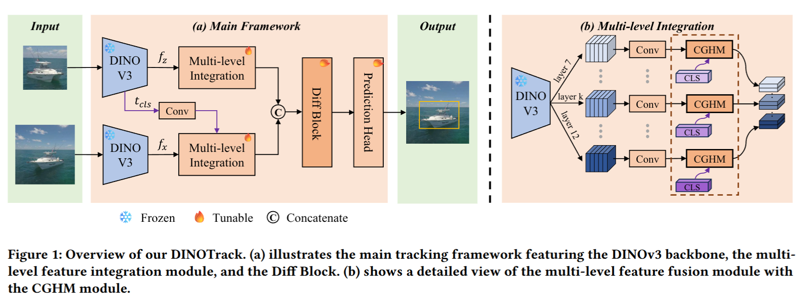

# DINOTrack

English | [中文](./README_zh.md)

**Unofficial repository**

This project is an independent reproduction of **DINOTrack** (paper: [DINOTrack: Leverage Differential Attention for Noise-Aware Visual Tracking with DINOv3](https://doi.org/10.1145/3805622.3810664), ACM ICMR 2026). The code follows the overall [STARK](https://github.com/researchmm/Stark) / [PyTracking](https://github.com/visionml/pytracking) framework; the concrete implementation changes are modeled after [OSTrack](https://github.com/botaoye/OSTrack); the backbone is initialized from [DINOv3](https://github.com/facebookresearch/dinov3) pretrained weights.

## Framework



## Performance

Paper-reported values vs. this reproduction (five general benchmarks, percentage scale).

**Headline metrics:**

| Benchmark | Paper | Ours |
|---|---:|---:|
| LaSOT (AUC) | 69.5 | 68.91 |
| GOT-10k^test (AO) | 70.4 | **70.50** |
| TNL2K^test (AUC) | 55.6 | 55.22 |
| LaSOT^ext (AUC) | 46.9 | 45.94 |
| TrackingNet (AUC) | 82.6 | **83.07** |

**Local official-protocol benchmarks** (21-point AUC, per-axis P_norm / P):

<table>
  <thead>
    <tr>
      <th rowspan="2">Model</th>
      <th colspan="3" align="center">LaSOT</th>
      <th colspan="3" align="center">TNL2K<sup>test</sup></th>
      <th colspan="3" align="center">LaSOT<sup>ext</sup></th>
    </tr>
    <tr>
      <th>AUC</th><th>P_norm</th><th>P</th>
      <th>AUC</th><th>P_norm</th><th>P</th>
      <th>AUC</th><th>P_norm</th><th>P</th>
    </tr>
  </thead>
  <tbody>
    <tr>
      <td>Paper</td>
      <td align="right">69.5</td><td align="right">80.2</td><td align="right">75.8</td>
      <td align="right">55.6</td><td align="right">—</td><td align="right">56.2</td>
      <td align="right">46.9</td><td align="right">57.4</td><td align="right">53.3</td>
    </tr>
    <tr>
      <td>Ours</td>
      <td align="right">68.91</td><td align="right">79.00</td><td align="right">74.03</td>
      <td align="right">55.22</td><td align="right">63.60</td><td align="right">56.08</td>
      <td align="right">45.94</td><td align="right">52.34</td><td align="right">51.41</td>
    </tr>
  </tbody>
</table>

**Official-server benchmarks:**

<table>
  <thead>
    <tr>
      <th rowspan="2">Model</th>
      <th colspan="3" align="center">GOT-10k<sup>test</sup></th>
      <th colspan="3" align="center">TrackingNet</th>
    </tr>
    <tr>
      <th>AO</th><th>SR0.50</th><th>SR0.75</th>
      <th>AUC</th><th>P_norm</th><th>P</th>
    </tr>
  </thead>
  <tbody>
    <tr>
      <td>Paper</td>
      <td align="right">70.4</td><td align="right">81.1</td><td align="right">65.9</td>
      <td align="right">82.6</td><td align="right">87.4</td><td align="right">80.8</td>
    </tr>
    <tr>
      <td>Ours</td>
      <td align="right"><strong>70.50</strong></td><td align="right">80.80</td><td align="right"><strong>67.80</strong></td>
      <td align="right"><strong>83.07</strong></td><td align="right"><strong>87.84</strong></td><td align="right"><strong>81.51</strong></td>
    </tr>
  </tbody>
</table>

Notes:

- Speed: the paper reports 61.4 fps; this reproduction runs at ~30.7–34.0 fps on a single RTX 3090.

## Quick Start

All commands below are run from the repository root. The training and evaluation entry points require the repo root on `PYTHONPATH` (only `tracking/test.py` adds it automatically); export once before starting:

```bash
export PYTHONPATH=.
```

### Installation

Create the conda environment from [environment.yaml](environment.yaml), pinned from the environment actually used for this reproduction (python 3.11 + torch 2.6.0+cu124 + transformers 5.x):

```bash
conda env create -f environment.yaml
conda activate dinotrack
```

> - The pip section includes `--extra-index-url https://download.pytorch.org/whl/cu124` to fetch the `+cu124` torch builds; a CUDA 12.4-compatible NVIDIA driver is required.
> - The optional `jpeg4py` dependency (faster JPEG decoding) is excluded from the pinned list: it needs system libjpeg headers to compile; the code falls back to OpenCV decoding automatically when it is absent.

### Pretrained Weights

Option 1: download the `dinov3-vitb16-pretrain-lvd1689m` weights (a HuggingFace snapshot directory containing `config.json` and `model.safetensors`) from the official [Meta DINOv3 release](https://github.com/facebookresearch/dinov3) and place the whole directory at `models/dinov3-vitb16-pretrain-lvd1689m`.
Option 2: download the same-named snapshot from ModelScope.

The code loads the backbone via `transformers.AutoModel.from_pretrained` using a repo-root-relative path; the `models/` directory is already git-ignored. Use of DINOv3 weights is subject to [their own license](https://github.com/facebookresearch/dinov3/blob/main/LICENSE).

**The trained ep0245 checkpoint of this reproduction** is available from [Releases v1.0.0](https://github.com/120L021610/DINOTrack/releases/tag/v1.0.0) (~397 MB; tensors and primitives only, safe to load with `weights_only=True`; SHA-256 on the release page):

```bash
wget https://github.com/120L021610/DINOTrack/releases/download/v1.0.0/DINOTrack_ep0245.pth.tar
mv DINOTrack_ep0245.pth.tar output/checkpoints/train/dinotrack/vitb16_full_1gpu/
```

You can then skip training and reproduce the reported metrics directly with the commands in the Evaluation section (`--ckpt` pointing at this file).

### Project Paths

Generate the default local files and edit them:

```bash
python tracking/create_default_local_file.py --workspace_dir . --data_dir ./data --save_dir ./output
```

…or copy the provided templates and fill in your own paths:

```bash
cp lib/train/admin/local.py.example lib/train/admin/local.py
cp lib/test/evaluation/local.py.example lib/test/evaluation/local.py
```

`local.py` holds machine-specific paths and is **git-ignored** — it is never committed.

### Data Preparation

Put the datasets under `./data` (or point to them directly in `local.py`):

```
${PROJECT_ROOT}
 -- data
     -- lasot
     -- got10k      (test / train / val)
     -- coco        (annotations / images/train2017)
     -- trackingnet (TRAIN_0 ... TRAIN_11 / TEST)
     -- tnl2k                     (optional, for TNL2K evaluation)
     -- lasot_extension_subset    (optional, for LaSOT-ext evaluation)
```

### Training

```bash
# paper recipe, single GPU (batch 128, 245 epochs, ~34 hours)
python tracking/train.py --script dinotrack --config vitb16_full_1gpu --save_dir ./output --mode single

# multi-GPU variant (8 GPU × batch 16 + SyncBN, reproducing the single-GPU batch-128 BN statistics)
python tracking/train.py --script dinotrack --config vitb16_full_8gpu --save_dir ./output --mode multiple --nproc_per_node 8
```

`experiments/dinotrack` currently provides two configs: `vitb16_full_1gpu` / `vitb16_full_8gpu`. Checkpoints are written to `output/checkpoints/train/dinotrack/<config>/DINOTrack_epXXXX.pth.tar` (ep0100 / ep0200 / final ep0245). [wandb](https://github.com/wandb/client) logging is **off** by default; add `--use_wandb 1` to enable it.

### Evaluation

The main evaluation entry point is `lib.test.dinotrack_eval.run`; `--dataset` accepts `lasot` / `tnl2k` / `lasot_ext` / `got10k_val` / `got10k_test` / `trackingnet`:

```bash
CKPT=output/checkpoints/train/dinotrack/vitb16_full_1gpu/DINOTrack_ep0245.pth.tar

# offline benchmarks (prints AUC / P_norm / P directly)
python -m lib.test.dinotrack_eval.run \
    --config experiments/dinotrack/vitb16_full_1gpu.yaml \
    --ckpt $CKPT --dataset lasot --out output/test/ep0245/lasot

# GOT-10k test submission package
python -m lib.test.dinotrack_eval.run \
    --config experiments/dinotrack/vitb16_full_1gpu.yaml \
    --ckpt $CKPT --dataset got10k_test --out output/test/ep0245/got10k_test
python -m lib.test.dinotrack_eval.package_submission \
    --per-seq output/test/ep0245/got10k_test/per_seq \
    --dataset got10k --out output/test/ep0245/got10k_test/submit_got10k_test.zip --fps 30

# TrackingNet submission package
python -m lib.test.dinotrack_eval.run \
    --config experiments/dinotrack/vitb16_full_1gpu.yaml \
    --ckpt $CKPT --dataset trackingnet --out output/test/ep0245/trackingnet
python -m lib.test.dinotrack_eval.package_submission \
    --per-seq output/test/ep0245/trackingnet/per_seq \
    --dataset trackingnet --out output/test/ep0245/trackingnet/submit_trackingnet.zip
```

For cluster environments, pass `--seqs <file>` to evaluate a shard of the sequences and merge the shards with `merge_shards.py`; `got10k_test` / `trackingnet` have no public ground truth, so results are packaged into official submission files with `package_submission.py`.

### Visualization

Candidate-elimination visualization uses the upstream [Visdom](https://github.com/fossasia/visdom) channel (`tracking/test.py` entry; note the dataset flag is `--dataset_name`):

1. Start a visdom server: `visdom`.
2. Run inference with `--debug 1`, e.g.:

   `python tracking/test.py dinotrack vitb16_full_1gpu --dataset_name lasot --threads 1 --num_gpus 1 --debug 1`
3. Open `http://localhost:8097` (adjust host/port as needed) to inspect the candidate-elimination process.

## Acknowledgments

- [STARK](https://github.com/researchmm/Stark) and [PyTracking](https://github.com/visionml/pytracking): the overall framework this reproduction follows.
- [OSTrack](https://github.com/botaoye/OSTrack): the implementation the concrete changes are modeled after.
- [DINOTrack](https://github.com/botaoye/DINOTrack): origin of the one-stream framework and CGHM.
- Meta's [DINOv3](https://github.com/facebookresearch/dinov3): the pretrained backbone used by this reproduction.

## License

This repository is distributed under the same license as the official DINOTrack implementation (see [LICENSE](LICENSE)). The DINOv3 backbone weights are governed by their own license — see the note above.

## Citation

If DINOTrack is useful for your research, please cite:

```Bibtex
@inbook{10.1145/3805622.3810664,
author = {Xu, Wei and Geng, Gu and Yuan, Di and Chen, Rui and Liu, Qiao},
title = {DINOTrack: Leverage Differential Attention for Noise-Aware Visual Tracking with DINOv3},
year = {2026},
isbn = {9798400726170},
publisher = {Association for Computing Machinery},
address = {New York, NY, USA},
url = {https://doi.org/10.1145/3805622.3810664},
pages = {1450–1458},
numpages = {9}
}
```
