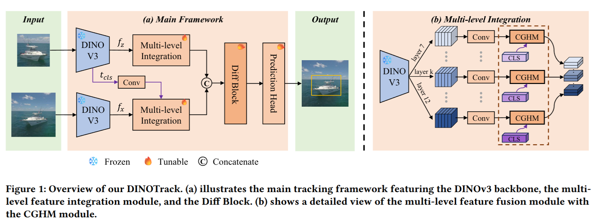

# DINOTrack

[English](README.md) | 中文

**非官方代码库**

本项目是对 **DINOTrack**（论文：[DINOTrack: Leverage Differential Attention for Noise-Aware Visual Tracking with DINOv3](https://doi.org/10.1145/3805622.3810664)，ACM ICMR 2026）的独立复现。代码遵循 [STARK](https://github.com/researchmm/Stark) / [PyTracking](https://github.com/visionml/pytracking) 的整体框架，具体实现参照 [OSTrack](https://github.com/botaoye/OSTrack) 进行改动；骨干网络的预训练权重来自 [DINOv3](https://github.com/facebookresearch/dinov3)。

## Framework



## 性能

论文报告值与本复现结果（五个通用基准，百分制）。

**核心指标一览：**

| 基准 | 论文 | 本复现 |
|---|---:|---:|
| LaSOT（AUC） | 69.5 | 68.91 |
| GOT-10k^test（AO） | 70.4 | **70.50** |
| TNL2K^test（AUC） | 55.6 | 55.22 |
| LaSOT^ext（AUC） | 46.9 | 45.94 |
| TrackingNet（AUC） | 82.6 | **83.07** |

**本地官方协议基准**（21 点 AUC、逐轴归一化 P_norm / P）：

<table>
  <thead>
    <tr>
      <th rowspan="2">Model</th>
      <th colspan="3" align="center">LaSOT</th>
      <th colspan="3" align="center">TNL2K<sup>test</sup></th>
      <th colspan="3" align="center">LaSOT<sup>ext</sup></th>
    </tr>
    <tr>
      <th>AUC</th><th>P_norm</th><th>P</th>
      <th>AUC</th><th>P_norm</th><th>P</th>
      <th>AUC</th><th>P_norm</th><th>P</th>
    </tr>
  </thead>
  <tbody>
    <tr>
      <td>论文</td>
      <td align="right">69.5</td><td align="right">80.2</td><td align="right">75.8</td>
      <td align="right">55.6</td><td align="right">—</td><td align="right">56.2</td>
      <td align="right">46.9</td><td align="right">57.4</td><td align="right">53.3</td>
    </tr>
    <tr>
      <td>本复现</td>
      <td align="right">68.91</td><td align="right">79.00</td><td align="right">74.03</td>
      <td align="right">55.22</td><td align="right">63.60</td><td align="right">56.08</td>
      <td align="right">45.94</td><td align="right">52.34</td><td align="right">51.41</td>
    </tr>
  </tbody>
</table>

**官方服务器评测基准：**

<table>
  <thead>
    <tr>
      <th rowspan="2">Model</th>
      <th colspan="3" align="center">GOT-10k<sup>test</sup></th>
      <th colspan="3" align="center">TrackingNet</th>
    </tr>
    <tr>
      <th>AO</th><th>SR0.50</th><th>SR0.75</th>
      <th>AUC</th><th>P_norm</th><th>P</th>
    </tr>
  </thead>
  <tbody>
    <tr>
      <td>论文</td>
      <td align="right">70.4</td><td align="right">81.1</td><td align="right">65.9</td>
      <td align="right">82.6</td><td align="right">87.4</td><td align="right">80.8</td>
    </tr>
    <tr>
      <td>本复现</td>
      <td align="right"><strong>70.50</strong></td><td align="right">80.80</td><td align="right"><strong>67.80</strong></td>
      <td align="right"><strong>83.07</strong></td><td align="right"><strong>87.84</strong></td><td align="right"><strong>81.51</strong></td>
    </tr>
  </tbody>
</table>

说明：

- 速度：论文报 61.4 fps；本复现在单张 RTX 3090 上约 30.7–34.0 fps。

## 快速开始

以下命令均在仓库根目录执行；训练与评测入口要求仓库根在 `PYTHONPATH` 中（`tracking/test.py` 会自动加入路径，其余不会），开工前先导出一次：

```bash
export PYTHONPATH=.
```

### 环境安装

使用本复现实训环境全量固定的 [environment.yaml](environment.yaml) 创建 conda 环境（python 3.11 + torch 2.6.0+cu124 + transformers 5.x）：

```bash
conda env create -f environment.yaml
conda activate dinotrack
```

> - pip 段自带 `--extra-index-url https://download.pytorch.org/whl/cu124` 拉取 `+cu124` 版 torch，需要 CUDA 12.4 兼容的 NVIDIA 驱动。
> - 可选依赖 `jpeg4py`（更快的 JPEG 解码）已从固定列表剔除：它需要系统 libjpeg 开发头文件才能编译；缺失时代码自动回退 OpenCV 解码。

### 预训练权重

方法一：从官方 [Meta DINOv3 发布](https://github.com/facebookresearch/dinov3) 下载 `dinov3-vitb16-pretrain-lvd1689m` 权重（HuggingFace snapshot 目录，含 `config.json` 与 `model.safetensors`），将整个目录放到 `models/dinov3-vitb16-pretrain-lvd1689m`。
方法二：从 ModelScope 下载同名 snapshot。

代码通过 `transformers.AutoModel.from_pretrained` 以仓库根相对路径加载；`models/` 目录已被 git 忽略。DINOv3 权重的使用受其[自身许可证](https://github.com/facebookresearch/dinov3/blob/main/LICENSE) 约束。

### 项目路径

生成默认本地配置文件后再行编辑：

```bash
python tracking/create_default_local_file.py --workspace_dir . --data_dir ./data --save_dir ./output
```

……或复制本仓库提供的模板并填写自己的路径：

```bash
cp lib/train/admin/local.py.example lib/train/admin/local.py
cp lib/test/evaluation/local.py.example lib/test/evaluation/local.py
```

`local.py` 保存的是与本机相关的路径，已被 **git 忽略**，不会被提交。

### 数据准备

将数据集放到 `./data` 目录下（或直接在 `local.py` 中指向实际路径）：

```
${PROJECT_ROOT}
 -- data
     -- lasot
     -- got10k      (test / train / val)
     -- coco        (annotations / images/train2017)
     -- trackingnet (TRAIN_0 ... TRAIN_11 / TEST)
     -- tnl2k                     (可选，用于 TNL2K 评测)
     -- lasot_extension_subset    (可选，用于 LaSOT-ext 评测)
```

### 训练

```bash
# 论文配方的单卡复现（batch 128，245 epochs，约 34 小时）
python tracking/train.py --script dinotrack --config vitb16_full_1gpu --save_dir ./output --mode single

# 多卡变体（8 GPU × batch 16 + SyncBN，复现单卡 batch-128 的 BN 统计）
python tracking/train.py --script dinotrack --config vitb16_full_8gpu --save_dir ./output --mode multiple --nproc_per_node 8
```

`experiments/dinotrack` 当前提供 `vitb16_full_1gpu` / `vitb16_full_8gpu` 两个配置。checkpoint 写入 `output/checkpoints/train/dinotrack/<config>/DINOTrack_epXXXX.pth.tar`（ep0100 / ep0200 / 最终 ep0245）。默认**不使用** [wandb](https://github.com/wandb/client)；需要在线记录时加 `--use_wandb 1`。

### 评估

主评测入口是 `lib.test.dinotrack_eval.run`，`--dataset` 可选 `lasot` / `tnl2k` / `lasot_ext` / `got10k_val` / `got10k_test` / `trackingnet`：

```bash
CKPT=output/checkpoints/train/dinotrack/vitb16_full_1gpu/DINOTrack_ep0245.pth.tar

# 离线评测基准（直接打印 AUC / P_norm / P）
python -m lib.test.dinotrack_eval.run \
    --config experiments/dinotrack/vitb16_full_1gpu.yaml \
    --ckpt $CKPT --dataset lasot --out output/test/ep0245/lasot

# GOT-10k 测试集提交包
python -m lib.test.dinotrack_eval.run \
    --config experiments/dinotrack/vitb16_full_1gpu.yaml \
    --ckpt $CKPT --dataset got10k_test --out output/test/ep0245/got10k_test
python -m lib.test.dinotrack_eval.package_submission \
    --per-seq output/test/ep0245/got10k_test/per_seq \
    --dataset got10k --out output/test/ep0245/got10k_test/submit_got10k_test.zip --fps 30

# TrackingNet 提交包
python -m lib.test.dinotrack_eval.run \
    --config experiments/dinotrack/vitb16_full_1gpu.yaml \
    --ckpt $CKPT --dataset trackingnet --out output/test/ep0245/trackingnet
python -m lib.test.dinotrack_eval.package_submission \
    --per-seq output/test/ep0245/trackingnet/per_seq \
    --dataset trackingnet --out output/test/ep0245/trackingnet/submit_trackingnet.zip
```

集群分片评测：给 `--seqs <file>` 传序列列表子集，各分片跑完后用 `merge_shards.py` 合并；`got10k_test` / `trackingnet` 无公开 GT，由 `package_submission.py` 打包成官方提交件。

### 可视化

候选消除过程的可视化沿用上游的 [Visdom](https://github.com/fossasia/visdom) 通道（`tracking/test.py` 入口，注意数据集参数是 `--dataset_name`）：

1. 启动 visdom 服务：`visdom`。
2. 推理时加 `--debug 1`，例如：

   `python tracking/test.py dinotrack vitb16_full_1gpu --dataset_name lasot --threads 1 --num_gpus 1 --debug 1`
3. 打开 `http://localhost:8097`（按实际情况调整 IP 与端口），即可查看候选消除过程。

## 致谢

- [STARK](https://github.com/researchmm/Stark) 与 [PyTracking](https://github.com/visionml/pytracking)：本复现所遵循的整体框架。
- [OSTrack](https://github.com/botaoye/OSTrack)：本复现具体改动所参照的实现。
- [DINOTrack](https://github.com/botaoye/DINOTrack)：单流框架与 CGHM 等的来源。
- Meta 的 [DINOv3](https://github.com/facebookresearch/dinov3)：本复现使用的骨干网络预训练权重。

## 许可证

本仓库与官方 DINOTrack 实现采用相同的许可证（见 [LICENSE](LICENSE)）。DINOv3 骨干权重受其自身许可证约束 —— 见上文说明。

## 引用

如果 DINOTrack 对你的研究有帮助，请引用：

```Bibtex
@inbook{10.1145/3805622.3810664,
author = {Xu, Wei and Geng, Gu and Yuan, Di and Chen, Rui and Liu, Qiao},
title = {DINOTrack: Leverage Differential Attention for Noise-Aware Visual Tracking with DINOv3},
year = {2026},
isbn = {9798400726170},
publisher = {Association for Computing Machinery},
address = {New York, NY, USA},
url = {https://doi.org/10.1145/3805622.3810664},
pages = {1450–1458},
numpages = {9}
}
```
